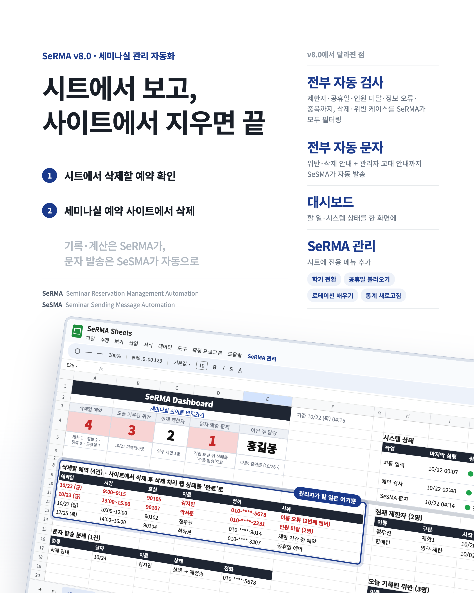
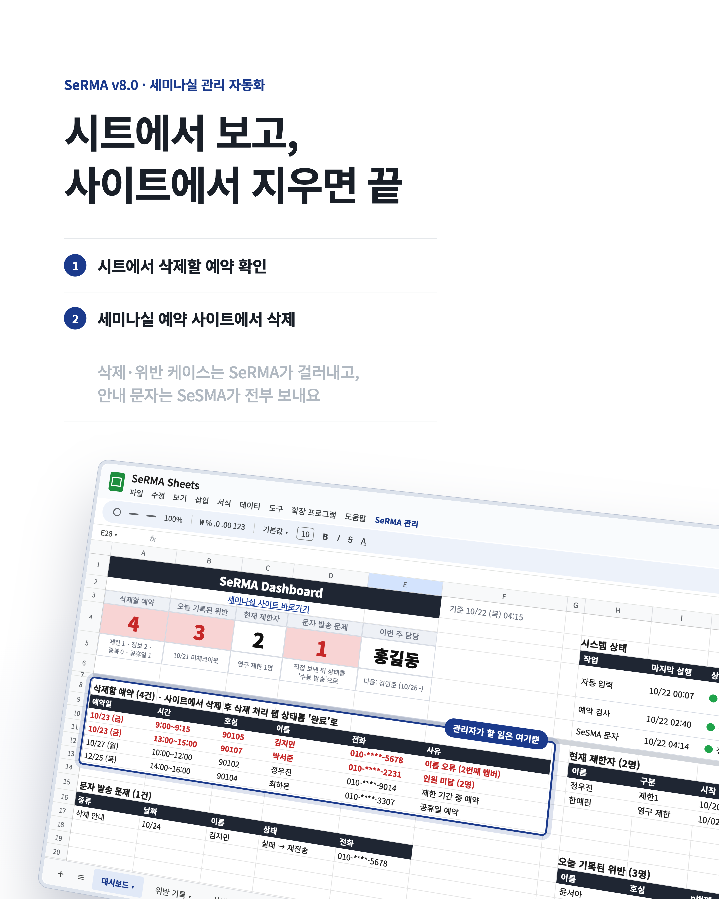
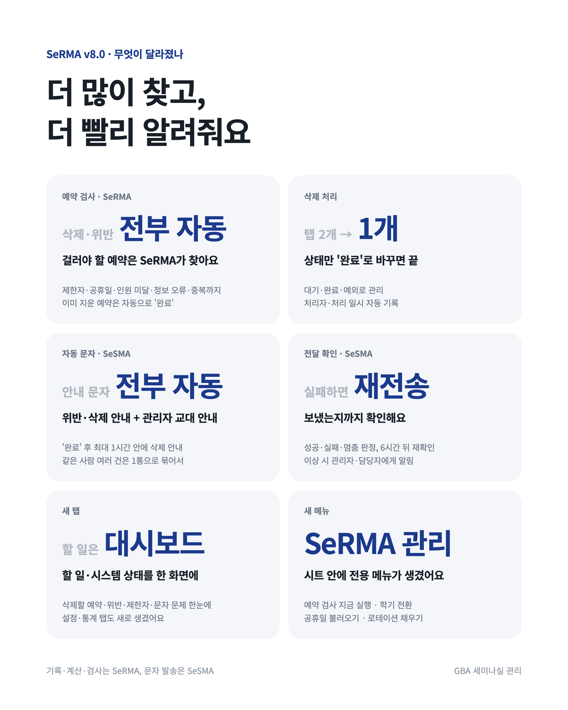

<div align="center">

# SeRMA

**Seminar Reservation Management Automation** · **Seminar Sending Message Automation**

Automates the day-to-day management of a seminar room booking site, without touching the site itself.

[](LICENSE)




</div>

> **Check the sheet, delete on the site, done.**
> SeRMA keeps the records and does the math; SeSMA sends the texts.

SeRMA was built for the student council of the Global Business Administration department at Sungkyunkwan University (SKKU) to run its seminar rooms, and has been in production since the fall 2026 semester.

- **SeRMA**: the whole system — a Google Sheets admin sheet plus Apps Script
- **SeSMA**: the text-message bot that runs on a Mac (`sesma/main.py`)

> The admin sheet, the text templates and the setup guide are in Korean. The code itself is commented in Korean as well.

---

## Why

The booking site is a separate project that is hard to change. Admins used to go through it every day to find people who never checked out, count their violations and work out ban periods by hand, look for bookings that broke the rules, and text each student one by one.

SeRMA does that work from outside the site. It only **reads** the site's data; decisions and records live in the sheet, and students are contacted by SMS.

## What it does

| Manual work before | What SeRMA does |
|---|---|
| Finding people who didn't check out | Every day at 00:05, logs yesterday's unchecked-out bookings |
| Counting violations, sanction levels and ban periods | Sheet formulas compute them, keyed by **phone number** (so people with the same name aren't mixed up) |
| Finding banned users and invalid bookings | Runs **9 checks** 19 times a day: banned users, permanently banned users, holidays, duplicate bookings, too few people, bad student ID / name / phone, duplicate student IDs |
| Texting violation and cancellation notices | SeSMA sends them automatically and **verifies that each one was actually delivered** |
| Telling admins when their shift changes | Sends handover notices on Sunday evening and Monday morning |
| Keeping track of everything | One **dashboard**: to-dos, system health, failed messages |
| Semester statistics | Violation trends, room utilization, no-checkout rate, deletion reasons, message success rate |

All an admin has to do is **check the bookings to delete → delete them on the site → mark them "done"**.

<table>
<tr>
<td></td>
<td></td>
</tr>
</table>

## Architecture

```
 Students ──book / check out──▶ Booking site (Next.js + Firebase, separate project)
                                  │  Firestore (names, phones etc. are AES-encrypted)
                                  ▼  read-only, with an admin account
             ┌──────── Apps Script (apps_script/, bound to the admin sheet) ────────┐
             │ 00:05          yesterday's no-checkouts → "Violations" tab           │
             │ 2, 5, 7–23h    booking checks → "Deletions" tab (pending)             │
             │ on edit        records who handled it and when                       │
             │ every 10 min   tidies the dashboard                                  │
             └───────────────────────────────────────────────────────────────────────┘
                                  ▼
             Admin sheet: Dashboard · Violations · Deletions · Stats · Settings
                                  │ ▲ delivery status and heartbeat
                                  ▼ │
             SeSMA (sesma/main.py, macOS launchd, hourly 05–23h)
             Messages app on the Mac → paired iPhone (Text Message Forwarding) → student SMS
             Reads ~/Library/Messages/chat.db to classify each message: sent / failed / stuck
```

**Design principles**
- **The sheet computes; scripts only read and write.** Sanction rules, semesters and which checks run are all numbers and checkboxes on the Settings tab.
- **The site is read-only.** A person always confirms and deletes bookings by hand.
- **Sending a text isn't the same as delivering it.** SeSMA checks `chat.db` for the real result, retries once on failure, and reports problems to the sheet and the admin.

## Repository layout

```
SeRMA/
├─ apps_script/            13 Apps Script files for the admin sheet
├─ sesma/
│   ├─ main.py             text-message bot
│   ├─ config.example.json copy to config.json and fill in (git-ignored)
│   ├─ requirements.txt
│   └─ com.seminar.sms.plist.example   launchd schedule example
└─ docs/
    ├─ SETUP.md            installation guide (Korean)
    └─ images/             overview images (sample data)
```

| Apps Script file | Role |
|---|---|
| `Config.gs` | Shared settings, column definitions, helpers |
| `Crypto.gs` | Firebase sign-in, Firestore REST queries, AES-CBC decryption |
| `Automation.gs` | Daily violation logging, trigger setup |
| `RestrictedCheck.gs` | Booking checks, deletion confirmation, auto-adding permanent bans |
| `Validation.gs` | Booking data checks, automatic DB schema detection |
| `ReservationLog.gs` | Booking ledger for statistics (no personal data) |
| `Dashboard.gs` | Dashboard with auto-resizing lists |
| `Settings.gs` | Settings tab, sanction table, semesters, holiday import |
| `Stats.gs` | Statistics tab, importing past semesters |
| `Setup.gs` | Builds the whole sheet from an empty spreadsheet |
| `Menu.gs` | "SeRMA 관리" menu in the sheet |
| `Logger.gs` | Run log and system status |
| `WebApp.gs` | Manual-run button page |

## Getting started

```bash
git clone https://github.com/joony06/SeRMA.git
```

See **[docs/SETUP.md](docs/SETUP.md)** for the full guide. In short:

1. Create an empty Google Sheet → Extensions > Apps Script, and paste in the 13 files from `apps_script/`
2. Set the time zone to Seoul and add five script properties (Firebase credentials and AES key/IV)
3. Run `setupNewStructure`, then `installTriggers`
4. On a Mac, set up `sesma/`: `config.json`, a service account, and launchd

### Using it with a different booking site

The code assumes a specific Firestore layout:

- a `reservations` collection
- `date`: a string in `Date.toDateString()` format
- `timeFrom` / `timeTo`: 15-minute slots counted from 09:00
- `roomId`: 1–8
- `checkOut`: whether the booking was checked out
- AES-encrypted `name` and `phone`, plus an array of members

If your site differs, adjust `FIELDS` and `ROOM_MAP` in `Config.gs`, `parseReservation_` in `Crypto.gs`, and `SCHEMA_OVERRIDE` in `Validation.gs`. The message templates (`TEMPLATES` in `sesma/main.py`) mention the department by name, so change those too.

## Security

- No secrets are in the code. Firebase credentials and the AES key/IV live in **Apps Script script properties**.
- Phone numbers and the sheet ID live in `sesma/config.json`, which is git-ignored.
- Files SeSMA writes while running (`history.json`, `log.txt`, etc.) contain student names and phone numbers. **Never commit them.**
- The admin sheet stores names and phone numbers in plain text, so share it with admins only.

## License

[MIT](LICENSE) © Choi Wonjun
